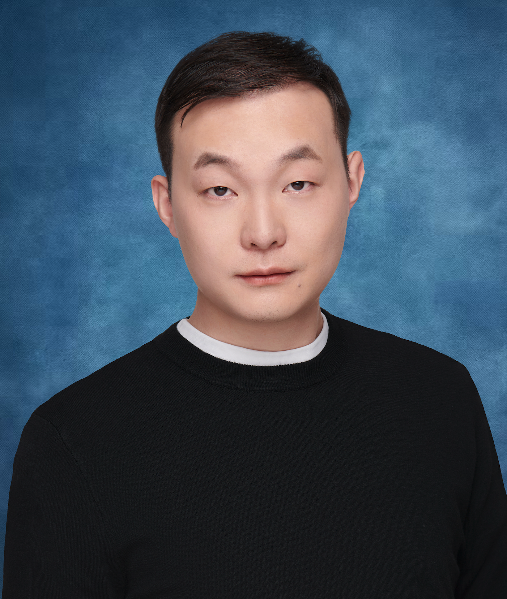
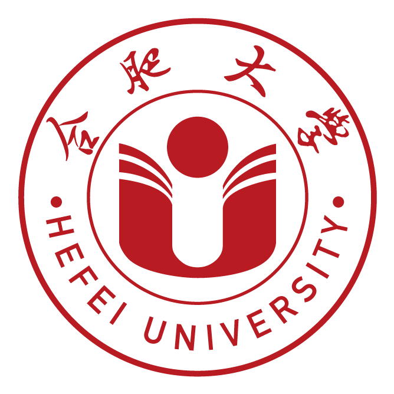

  

    <h1>Dehai Min &nbsp; 闵德海</h1>
    
👋 I am a second-year CS Ph.D. student (Aug. 2025–) at  <a href="https://www.uic.edu/">University of Illinois Chicago (UIC)</a>, advised by Prof. <a href="https://scholar.google.com/citations?user=D0lL1r0AAAAJ">Philip S. Yu</a> (Fellow of ACM, IEEE and AAAS). I am currently a Student Researcher at  <a href="https://www.microsoft.com/">Microsoft</a> CoreAI - GitHub Copilot team. Previously, I was a Research Scientist Intern at  <a href="https://www.bytedance.com/en/">ByteDance (San Jose)</a> Doubao MaaS Team in Summer 2026. I received my M.S. from Southeast University, advised by Prof. <a href="https://scholar.google.com/citations?user=1gw3LJQAAAAJ&hl=en">Guilin Qi</a>, and my B.S. from Hefei University. I am deeply grateful for the previous guidance from Prof. <a href="https://chenyuyou.me/">Chenyu You</a> from Stony Brook University.

    
My current research interests include:

    <ol>
      <li><strong>Agent Long-horizon Trace Evaluation & Agent Environment Reconstruction & Synthesis</strong></li>
      <li><strong>Retrieval-Augmented Generation (RAG) & Information Retrieval</strong></li>
      <li><strong>Efficient LLMs & LLM Uncertainty Quantification</strong></li>
    </ol>
    
Previously, during my master's studies, I worked on LLMs with heterogeneous data (text, graphs, and tables).

  

  

    
  

  <a href="mailto:dmin10@uic.edu">📧 Email</a> /
  <a href="https://scholar.google.com/citations?user=lVn0bHUAAAAJ">🎓 Google Scholar</a> /
  <a href="https://github.com/ZhishanQ">😺 Github</a> /
  <a href="https://twitter.com/qiezimin">🐦 Twitter</a> /
  <a href="https://www.linkedin.com/in/dehai-min-b2822829b/">💼 LinkedIn</a>

I am always open to research discussions and exploring internship opportunities — feel free to reach out!

## 🎉 News

<ul class="news-list">
  <li>[2026.10] Invited by  <strong>Apple</strong> to give a research talk on <a href="https://zhishanq.github.io/TraceDance/"><strong><em>TraceDance</em></strong></a>! 🎤</li>
  <li>[2026.10] Excited to share that I'm joining  <strong>Microsoft’s</strong> <strong>CoreAI - GitHub Copilot</strong> team as a <strong>student researcher</strong>, working on coding agents post-training and evaluation!</li>
  <li>[2026.09] New paper released: <a href="https://arxiv.org/abs/2609.33295"><strong><em>TraceDance</em></strong></a> — An Automated System for Building Agent Behavior Benchmarks from Real-World Agent Deployment Traces. Paper and project website are now available! <a href="https://arxiv.org/abs/2609.33295">📄 Paper</a> / <a href="https://zhishanq.github.io/TraceDance/">🌐 Website</a></li>
  <li>[2026.08] Two papers accepted: <a href="https://arxiv.org/abs/2607.08940"><strong><em>TSRouter</em></strong></a> by <strong>COLM 2026</strong> (<a href="https://arxiv.org/abs/2607.08940">📄 Paper</a> / <a href="https://github.com/tianyi-lab/TSRouter">📦 Code</a>) & <a href="https://arxiv.org/abs/2601.03471"><strong><em>EpiQAL</em></strong></a> by <strong>EMNLP 2026</strong>! 🎉</li>
  <li>[2026.06] New paper: <a href="https://arxiv.org/abs/2605.17672"><strong><em>Stop When Reasoning Converges</em></strong></a> — Semantic-Preserving Early Exit for Reasoning Models (<strong>PUMA</strong>). <a href="https://arxiv.org/abs/2605.17672">📄 Paper</a> / <a href="https://github.com/giovanni-vaccarino/PUMA">📦 Code</a> / <a href="https://huggingface.co/collections/ZhishanQ/puma">🤗 Models & Datasets</a></li>
  <li>[2026.06] New paper (co-first): <a href="https://arxiv.org/abs/2605.29648"><strong><em>CorVer</em></strong></a> — Verifiable Rewards Beyond Math and Code: Lightweight Corpus-Grounded Process Supervision for Factual Question Answering. <a href="https://arxiv.org/abs/2605.29648">📄 Paper</a> / <a href="https://github.com/shichengf/CorVer">📦 Code</a></li>
  <li>[2026.05] Moved to San Jose, CA (Bay Area) to start as a <strong>Research Scientist Intern @  ByteDance</strong>, working with the Doubao Agent Team at AML / Volcano Engine-Ark.</li>
  <li>[2026.05] Two papers (<a href="https://arxiv.org/abs/2602.10229"><strong><em>Latent Thoughts Tuning</em></strong></a> & <a href="https://arxiv.org/abs/2511.14159"><strong><em>MVI-Bench</em></strong></a>) accepted by <strong>ICML 2026</strong>! 🎉</li>
  <li>[2026.04] One paper (<strong><em>QuCo-RAG</em></strong>) accepted by <strong>ACL Findings 2026</strong>! <a href="https://arxiv.org/abs/2512.19134">📄 Paper</a> / <a href="https://github.com/ZhishanQ/QuCo-RAG">📦 Code</a> / Covered by <a href="https://mp.weixin.qq.com/s/2hcm6AvMxh39XS7RECjXLA">🔥 新智元</a>. Thanks to Dr. <a href="https://lcheng.org/">Cheng</a> for her guidance!</li>
  <li>[2026.02] New paper on latent reasoning: <strong><em>Latent Thoughts Tuning</em></strong> — Bridging Context and Reasoning with Fused Information in Latent Tokens. <a href="https://arxiv.org/abs/2602.10229">📄 Paper</a> / <a href="https://github.com/NeosKnight233/Latent-Thoughts-Tuning">📦 Code</a></li>
  <li>[2025.12] Selected as <strong>Outstanding Reviewer of 2024–2025</strong> for IEEE TNNLS! <a href="https://zhishanq.github.io/files/TNNLS_Outstanding_reviewer_Dehai_Min.pdf">📦 Certificate</a></li>
  <li>[2025.12] New paper released: <strong><em>MVI-Bench</em></strong> — Evaluating Robustness to Misleading Visual Inputs in LVLMs. <a href="https://arxiv.org/abs/2511.14159">📄 Paper</a> / <a href="https://github.com/chenyil6/MVI-Bench">📦 Code</a></li>
  <li>[2025.08] Moved to Chicago 🇺🇸.</li>
  <li>[2025.01] 🎉 One paper (<a href="https://arxiv.org/abs/2410.20163">UniHGKR</a>) accepted by <strong>NAACL 2025</strong> as <strong>Oral</strong>, with the highest meta-review score of 5! <a href="https://github.com/ZhishanQ/UniHGKR">📦 Code</a> / <a href="https://huggingface.co/collections/ZhishanQ/unihgkr-6846b60973fa75b04681a388">🤗 Models & Datasets</a></li>
  <li>[2024.12] One paper accepted by <strong>AAAI 2025</strong>!</li>
</ul>

## 🎓 Education

  
  
<strong>University of Illinois Chicago</strong> , Ph.D. , <em>08/2025 - present</em>

  
  
<strong>Southeast University</strong> , M.S. , <em>09/2022 - 06/2025</em>

  
  
<strong>Hefei University</strong> , B.S. , <em>09/2017 - 06/2022</em>

## 🧑‍🏫 Internship

  
  
<strong>Microsoft</strong> , <em>10/2026 - </em> Student Researcher , United States · Remote CoreAI - GitHub Copilot Team. Coding agents post-training and evaluation.

  
  
<strong>ByteDance (TikTok)</strong> , <em>05/2026 - 08/2026</em> Research Scientist Intern , San Jose, California Doubao Enterprise Agent Team at AML / <a href="https://www.volcengine.com/product/ark">Volcano Engine-Ark</a>. Data flywheel from deployed API traffic back into Doubao Seed model training.

## 📝 Publications and Preprints
(\* denotes equal contribution.)

  

### First-author Publications

* **Dehai Min**, Daoan Zhang, Yiming Zeng, Huayi Zhang, Ziyi Chen, Yan Zhang, Qinbo Bai, Mengyuan Chao et al. [TraceDance: An Automated System for Building Agent Behavior Benchmarks from Real-World Agent Deployment Traces](https://arxiv.org/abs/2609.33295) Preprint
 [📄 Paper](https://arxiv.org/abs/2609.33295) / [🌐 Website](https://zhishanq.github.io/TraceDance/)

* **Dehai Min**\*, Giovanni Vaccarino\*, Huiyi Chen, Yongliang Wu, Gal Yona, Lu Cheng. [Stop When Reasoning Converges: Semantic-Preserving Early Exit for Reasoning Models](https://arxiv.org/abs/2605.17672) Preprint
 [📄 Paper](https://arxiv.org/abs/2605.17672) / [📦 Code](https://github.com/giovanni-vaccarino/PUMA)  / [🤗 Models & Datasets](https://huggingface.co/collections/ZhishanQ/puma) / 

* **Dehai Min**, Kailin Zhang, Tongtong Wu, Lu Cheng. [QuCo-RAG: Quantifying Uncertainty from the Pre-training Corpus for Dynamic Retrieval-Augmented Generation](https://arxiv.org/abs/2512.19134) ACL Findings 2026
 [📄 Paper](https://arxiv.org/abs/2512.19134) / [📦 Code](https://github.com/ZhishanQ/QuCo-RAG)  / 

* **Dehai Min**, Zhiyang Xu, Guilin Qi, Lifu Huang, and Chenyu You. [UniHGKR: Unified Instruction-aware Heterogeneous Knowledge Retrievers](https://arxiv.org/abs/2410.20163) NAACL 2025, Oral Highest Meta-Review Score: 5
 [📄 Paper](https://arxiv.org/abs/2410.20163) / [📦 Code](https://github.com/ZhishanQ/UniHGKR)  / [🤗 Models & Datasets](https://huggingface.co/collections/ZhishanQ/unihgkr-6846b60973fa75b04681a388)

* **Dehai Min**\*, Nan Hu\*, Rihui Jin, Nuo Lin, Jiaoyan Chen, Yongrui Chen, Yu Li et al. [Exploring the Impact of Table-to-Text Methods on Augmenting LLM-based Question Answering with Domain Hybrid Data](https://arxiv.org/abs/2402.12869) NAACL 2024, Oral
 [📄 Paper](https://arxiv.org/abs/2402.12869) / [🎤 Slides](https://zhishanq.github.io/files/Oral_for_NAACL_2024.pdf)

* Yiming Tan\*, **Dehai Min**\*, Yu Li, Wenbo Li, Nan Hu, Yongrui Chen, and Guilin Qi. [Can ChatGPT replace traditional KBQA models? An in-depth analysis of the question answering performance of the GPT LLM family](https://link.springer.com/chapter/10.1007/978-3-031-47240-4_19) ISWC 2023, Oral **370 Citations**
 [📄 Paper](https://link.springer.com/chapter/10.1007/978-3-031-47240-4_19) / [📦 Code](https://github.com/tan92hl/Complex-Question-Answering-Evaluation-of-GPT-family)  / [🎤 Slides](https://zhishanq.github.io/files/ISWC2023-oral_new.pdf)

* Shicheng Fan\*, Haochang Hao\*, **Dehai Min**\*, Weihao Liu, Philip S. Yu, Lu Cheng. [Verifiable Rewards Beyond Math and Code: Lightweight Corpus-Grounded Process Supervision for Factual Question Answering](https://arxiv.org/abs/2605.29648) Preprint
 [📄 Paper](https://arxiv.org/abs/2605.29648) / [📦 Code](https://github.com/shichengf/CorVer) 

### Selected Collaborative Publications

* Fangxu Yu, Tao Feng, **Dehai Min**, Lu Cheng, Ge Liu, Tianyi Zhou. [TSRouter: Dynamic Modality-Model Selection for Time Series Reasoning](https://arxiv.org/abs/2607.08940) COLM 2026
 [📄 Paper](https://arxiv.org/abs/2607.08940) / [📦 Code](https://github.com/tianyi-lab/TSRouter) 

* Weihao Liu, **Dehai Min**, Lu Cheng. [Latent Thoughts Tuning: Bridging Context and Reasoning with Fused Information in Latent Tokens](https://arxiv.org/abs/2602.10229) ICML 2026
 [📄 Paper](https://arxiv.org/abs/2602.10229) / [📦 Code](https://github.com/NeosKnight233/Latent-Thoughts-Tuning) 

* Mingyang Wei, **Dehai Min**, Zewen Liu, Yuzhang Xie, Guanchen Wu, Carl Yang, Max S.Y. Lau, Qi He, Lu Cheng, Wei Jin. [EpiQAL: Benchmarking Large Language Models in Epidemiological Question Answering for Enhanced Alignment and Reasoning](https://arxiv.org/abs/2601.03471) EMNLP 2026

* Huiyi Chen, Jiawei Peng, **Dehai Min**, Changchang Sun, Kaijie Chen, Yan Yan, Xu Yang, Lu Cheng. [MVI-Bench: A Comprehensive Benchmark for Evaluating Robustness to Misleading Visual Inputs in LVLMs](https://arxiv.org/abs/2511.14159) ICML 2026
 [📦 Code](https://github.com/chenyil6/MVI-Bench) 

## 🏅 Competitions
( I was an active participant in programming competitions during my undergraduate years. )

* **ACM-ICPC** (International Collegiate Programming Contest) , Asian Regional Contest (including all participating universities in mainland China), 2019-2020, **2 times Silver Medal**. [individual](https://zhishanq.github.io/images/ICPC_Individual.pdf) / [team](https://zhishanq.github.io/images/ICPC_Team.pdf)
* **CCPC-Finals** (China Collegiate Programming Contest National Finals), 2019, **21st place, Silver Medal**
* Anhui Province Collegiate Programming Contest, **First Prize (2 times, 2019, 2020), Champion🏆 (1 time, 2020)**
* Codeforces Rating: **2108 (Master)**, [link](https://codeforces.com/profile/QieziMin)

## 🎤 Invited Talks

  
  
Invited research talk on <a href="https://zhishanq.github.io/TraceDance/">TraceDance</a>: From Deployment Traces to Agent Behavior Benchmarks 🎤

  
<strong>Apple</strong> · 2026.10

## 👨‍💻 Academic Services

* **Outstanding Reviewer of 2024–2025**, IEEE TNNLS [📦 Certificate](https://zhishanq.github.io/files/TNNLS_Outstanding_reviewer_Dehai_Min.pdf)

* Reviewer of ACL, EMNLP, NAACL, ICML, NeurIPS, ICLR, AAAI

* Reviewer of IEEE Transactions on Neural Networks and Learning Systems (TNNLS)
